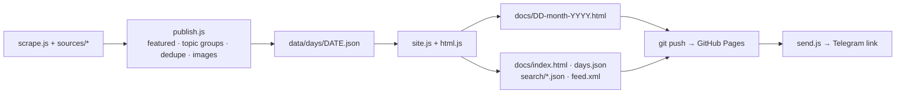

# TLDR Digest

A daily one-page news digest: all 14 [TLDR](https://tldr.tech) newsletters plus ~16 other
sources (AI labs, Hacker News, GitHub Trending, security outlets, world and Singapore
news), deduplicated, grouped by topic, and published as a static site with a short
Telegram message linking to it.

**Live site:** https://theborednerd0.github.io/tldr-digest/

## How it runs

Every day at 08:00 Singapore time, `.github/workflows/daily-digest.yml` runs
`node publish.js` on GitHub Actions:



Each day's data is stored as JSON in `data/days/`. Every page is rendered from that
data, so a template change can be applied to the whole archive with `npm run rebuild`.

### Site features
- **Day page**: Featured (AI models + GitHub repos), topic tiles and pills (link to one
  with `#ai`, `#world-news`, …), live search, card or compact list view, dark mode,
  read tracking, ☆ save, share / copy link, previous/next day.
- **Repeats**: stories already in the day before's digest are tagged; "Show new only"
  hides them. TLDR re-serves editions over weekends, so this is often 30–60% of a day.
- **Muted words**: a panel at the bottom of each day hides stories by keyword.
- **Keys**: `/` search · `j` / `k` next / previous story · `o` open · `s` save.
- **Home**: the latest digest, then every day grouped by month, newest first, with days
  you haven't opened marked.
- **Search every day** (`search.html`): headlines from every digest.
- **Saved** (`saved.html`): starred stories.
- **RSS** (`feed.xml`): one item per day.

Saved stories, read state, muted words and view settings are kept in your browser
(localStorage). There are no accounts and no tracking.

### Source health
Each day records which expected sources returned nothing (`missingSources` in
`data/days/<date>.json`), lists them at the foot of that day's page, and the Actions
run shows a warning. A source missing 3 days in a row gets a louder warning.

## Setup

1. Repo secret **`TELEGRAM_BOT_TOKEN`** (Settings → Secrets and variables → Actions): the
   token from @BotFather for the bot that sends the daily link.
   Optional: `TLDR_DIGEST_CHAT_ID` to override the default chat.
2. GitHub Pages: deploy from branch `main`, folder `/docs`.
3. To test: Actions → *Daily TLDR Digest* → **Run workflow**.

## Local commands

```bash
npm ci
npm test            # offline test suite (node:test, no network)
npm run rebuild     # re-render every page + archive/search/RSS from data/days
npm run publish     # full run: scrape, publish, git push, Telegram (needs the token)
npm run preview     # serve docs/ at http://localhost:8080/tldr-digest/
npm run backfill    # recover data/days from existing docs/*.html (one-off)
```

## Layout

| Path | What |
|---|---|
| `publish.js` | Daily entry point: fetch → Featured → topic groups → dedupe → images → write → push → Telegram |
| `scrape.js`, `sources/` | TLDR scraper, RSS helper (with retry), one module per source family |
| `site.js` | Day data (read/write/list), archive manifest, search index, writes cross-day files |
| `html.js` | All page templates, styles and the in-page script |
| `send.js` | Telegram Bot API sender |
| `scripts/` | `rebuild.js`, `backfill.js` |
| `test/` | `npm test`: node:test, offline; `client.test.js` runs the page script in jsdom |
| `index.js`, `format.js`, `state.js`, `scheduler.js` | Legacy per-edition Telegram flow (not scheduled) |

Detailed history and design decisions: [PROGRESS.md](PROGRESS.md).
